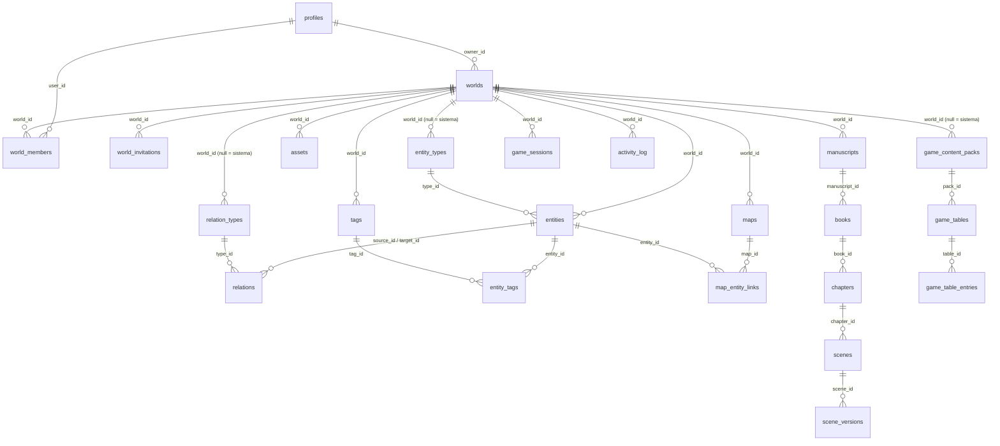

# Esquema de base de datos

> **Estado:** vigente desde el 15/11/2026 (issue
> [#9](https://github.com/gonzalitojh/world-craft/issues/9), M0-08).
> **Ámbito:** modelo de datos, integridad, búsqueda y aislamiento por mundo.
> **Fuente de verdad del código:** `src/lib/db/schema/` (tipos y diff) y
> `drizzle/*.sql` (estado aplicado). Este documento describe el resultado, no
> sustituye a las migraciones.
> **Decisión asociada:** [ADR 0019](../adr/0019-database-schema-migrations-and-rls.md).

## 1. Cómo se mantiene

| Pieza | Ruta | Responsabilidad |
|---|---|---|
| Esquema tipado | `src/lib/db/schema/*.ts` | Una tabla por archivo de dominio; sin `server-only` para que Drizzle Kit lo lea. |
| Migraciones | `drizzle/0000`–`0006` | Cadena lineal única; la `0001` la genera Drizzle Kit y el resto es SQL revisado. |
| Journal | `drizzle/meta/_journal.json` | Orden y comprobación de deriva (`pnpm db:check`). |
| Rollback | `drizzle/rollback/*.down.sql` | SQL de reversión documentado; **no** lo aplica ninguna herramienta. |
| Seed | `src/lib/db/seed/system-catalog.json` | Catálogo del sistema idempotente. |
| Verificación | `scripts/db/verify.mjs` | Comprueba tablas, enums, RLS, grants y conteos del seed. |

Reglas que no se negocian:

- Una migración aplicada **no se edita**: se corrige con otra migración.
- `drizzle-kit push` está **prohibido**: no versiona, no es reversible y puede
  borrar políticas, triggers y funciones que el esquema Drizzle no modela.
- Las políticas, triggers, funciones y privilegios se escriben en SQL explícito,
  no con el DSL de RLS de Drizzle.

## 2. Convenciones

- **Identificadores:** `uuid` con `gen_random_uuid()`, salvo
  `activity_log.id` (`bigint generated always as identity`).
- **Fechas:** `timestamptz` en UTC. `created_at`/`updated_at` con `default now()`
  y trigger `set_updated_at` donde existe `updated_at`.
- **Borrado lógico:** `deleted_at` en `entities`, `maps` y `scenes`. El resto se
  borra en cascada con su padre.
- **Posiciones:** `numeric(12,3)` con huecos (1000, 2000, 1500…) para reordenar
  sin reescribir filas vecinas.
- **Texto plano duplicado:** `entities.description_text` y
  `scenes.content_text`, para FTS, exportación y conteo de palabras.
- **JSONB:** contenido rico (`description`, `content`), atributos variables
  (`attributes`, `fields`, `metadata`), documentos de mapa (`document`, `style`,
  `bounds`) y ajustes (`settings`). Solo se indexa lo que se consulta.
- **Slugs:** minúsculas, dígitos y guiones, únicos por mundo y solo entre filas
  no borradas.
- **Enums en inglés:** las etiquetas de interfaz viven en `src/messages/`.

## 3. Diagrama entidad-relación

Solo se dibujan las relaciones que condicionan el acceso o la integridad; las
claves hacia `profiles` se omiten para no tapar la estructura.

## 4. Enums

| Enum | Valores | Se usa en |
|---|---|---|
| `world_role` | `owner`, `editor`, `viewer` | `world_members.role` y las funciones de rol. |
| `invitation_role` | `editor`, `viewer` | `world_invitations.role`; el `owner` no se invita, se transfiere. |
| `theme_preference` | `light`, `dark`, `system` | `profiles.theme`. |
| `world_status` | `draft`, `active`, `archived` | `worlds.status` (provisional). |
| `content_status` | `draft`, `in_progress`, `done`, `archived` | `entities`, `manuscripts`, `chapters`, `scenes` (provisional). |
| `manuscript_kind` | `novel`, `novella`, `short`, `saga` | `manuscripts.kind`. |
| `game_table_category` | `container`, `subgenre`, `trigger`, `trope`, `custom` | `game_tables.category`. |

Los valores de estado son **provisionales**: se validarán en las issues de
producto. Cambiarlos exige una migración que añada el valor al enum (PostgreSQL
no permite quitar valores sin recrear el tipo).

## 5. Diccionario de tablas

Notación: `PK` clave primaria, `FK` clave foránea, `UQ` única, `CHK` restricción
de comprobación. Todas las tablas viven en `public`.

### 5.1 Acceso y núcleo

| Tabla | Columnas y restricciones | Índices |
|---|---|---|
| `profiles` | `id uuid PK` → `auth.users(id)` `on delete cascade` (FK declarada en `0002`); `display_name text not null default ''`; `avatar_url text`; `theme theme_preference not null default 'system'`; `locale text not null default 'es'` con `CHK locale in ('es','en','it')`; `settings jsonb not null default '{}'`; `created_at`, `updated_at`. | `profiles_updated_at_idx`. |
| `allowed_emails` | `email text PK` con `CHK email = lower(email)` y `CHK position('@' in email) > 1`; `invited_by uuid` → `profiles` `on delete set null`; `note text`; `created_at`. | Solo la PK. |
| `worlds` | `id uuid PK`; `owner_id uuid not null` → `profiles` `on delete restrict`; `name text not null` con `CHK 1..160`; `slug text not null` con `CHK` de formato; `summary text not null default ''`; `description jsonb not null default '{}'`; `cover_asset_id uuid` → `assets` `on delete set null` (FK en `0002`); `genres text[] not null default '{}'`; `status world_status not null default 'draft'`; `settings jsonb not null default '{}'`; `archived_at timestamptz`; timestamps. | `worlds_owner_id_slug_key` UQ; `worlds_owner_id_idx`; `worlds_owner_id_updated_at_idx`. |
| `world_members` | `world_id uuid` → `worlds` `on delete cascade`; `user_id uuid` → `profiles` `on delete cascade`; `role world_role not null`; `created_at`, `updated_at`; `PK (world_id, user_id)`. | `world_members_one_owner_key` UQ parcial `where role = 'owner'`; `world_members_user_id_idx`. |
| `world_invitations` | `id uuid PK`; `world_id uuid` → `worlds` `on delete cascade`; `email text not null` con `CHK` en minúsculas; `role invitation_role not null`; `token_hash text not null` con `CHK` de 64 hex; `expires_at timestamptz not null` con `CHK expires_at > created_at`; `accepted_at timestamptz`; `created_by uuid` → `profiles` `on delete set null`; `created_at`. | `world_invitations_token_hash_key` UQ; UQ parcial `(world_id, email) where accepted_at is null`; `world_id_idx`; `email_idx`; `(world_id, expires_at)`. |

Notas:

- `worlds.owner_id` usa `on delete restrict`: borrar un perfil con mundos exige
  transferirlos o borrarlos antes.
- `world_members_one_owner_key` hace imposible tener dos `owner` en el mismo
  mundo a nivel de índice; los triggers añaden la comprobación contra
  `worlds.owner_id`.
- `token_hash` guarda un SHA-256: la invitación no se puede aceptar con el valor
  almacenado.

### 5.2 Taxonomías, fichas y relaciones

| Tabla | Columnas y restricciones | Índices |
|---|---|---|
| `entity_types` | `id uuid PK`; `world_id uuid` → `worlds` `on delete cascade` (**`null` = sistema**); `key text not null`; `name text not null`; `icon text`; `color text`; `fields jsonb not null default '[]'`; `is_system boolean not null default false`; timestamps. `CHK is_system = (world_id is null)`. | UQ parcial `(key) where world_id is null`; UQ parcial `(world_id, key) where world_id is not null`; `world_id_idx`. |
| `relation_types` | Igual que `entity_types` más `inverse_name text not null` (no tiene `fields`). | Mismas unicidades y `world_id_idx`. |
| `entities` | `id uuid PK`; `world_id` → `worlds` `on delete cascade`; `type_id` → `entity_types` `on delete restrict`; `name text not null` con `CHK 1..200`; `slug text not null` con `CHK` de formato; `aliases text[] not null default '{}'`; `summary text not null default ''`; `description jsonb not null default '{}'`; `description_text text not null default ''`; `image_asset_id uuid` → `assets` `on delete set null`; `attributes jsonb not null default '{}'`; `status content_status not null default 'draft'`; `is_favorite boolean not null default false`; `search_vector tsvector generated always as (…) stored`; timestamps; `deleted_at`. | UQ parcial `(world_id, slug) where deleted_at is null`; `world_id_idx`; `(world_id, type_id)`; `(world_id, updated_at desc)`; GIN `search_vector`; GIN trigram `name`; GIN trigram `app.immutable_array_to_string(aliases, ' ')`. |
| `relations` | `id uuid PK`; `world_id` → `worlds` `on delete cascade`; `source_id`, `target_id` → `entities` `on delete cascade`; `type_id` → `relation_types` `on delete restrict`; `label text`; `inverse_label text`; `notes text`; `strength smallint not null default 3` con `CHK 1..5`; `metadata jsonb not null default '{}'`; timestamps. `CHK source_id <> target_id`. | UQ `(world_id, source_id, target_id, type_id)`; `world_id_idx`; `source_id_idx`; `target_id_idx`; `type_id_idx`. |
| `tags` | `id uuid PK`; `world_id` → `worlds` `on delete cascade`; `name text not null`; `slug text not null` con `CHK` de formato; `color text`; timestamps. | UQ `(world_id, slug)`; `world_id_idx`. |
| `entity_tags` | `entity_id` → `entities` `on delete cascade`; `tag_id` → `tags` `on delete cascade`; `created_at`; `PK (entity_id, tag_id)`. | `entity_tags_tag_id_idx` (consultas inversas). |

Notas:

- `entity_types` y `relation_types` con `world_id null` son el catálogo del
  sistema: lo crea el seed y **ningún cliente** puede escribirlo (las políticas
  exigen `world_id is not null`).
- `entities.type_id` usa `on delete restrict`: un tipo con fichas no se borra.
- El índice trigram de `aliases` es sobre la expresión, así que PostgreSQL lo
  usa con la misma expresión en la consulta.

### 5.3 Assets

| Tabla | Columnas y restricciones | Índices |
|---|---|---|
| `assets` | `id uuid PK`; `world_id` → `worlds` `on delete cascade`; `uploader_id uuid` → `profiles` `on delete set null`; `bucket text not null`; `path text not null`; `mime text not null`; `size bigint not null` con `CHK size >= 0`; `width int`; `height int`; `alt text not null default ''`; `created_at`. `CHK path like 'world/' || world_id::text || '/%'`. | UQ `(world_id, path)`; `world_id_idx`; `(world_id, created_at desc)`. |

El binario no vive aquí: `bucket` + `path` apuntan a Cloudflare R2 (M0-10) y el
bucket es privado. El formato de clave y el contrato de almacenamiento se
describen en la sección 9.

### 5.4 Mapas

| Tabla | Columnas y restricciones | Índices |
|---|---|---|
| `maps` | `id uuid PK`; `world_id` → `worlds` `on delete cascade`; `name text not null`; `description text not null default ''`; `document jsonb not null default '{"type":"FeatureCollection","features":[]}'`; `style jsonb not null default '{}'`; `bounds jsonb`; `thumbnail_asset_id uuid` → `assets` `on delete set null`; `deleted_at`; timestamps. | `world_id_idx`; `(world_id, updated_at desc)`; parcial `(world_id) where deleted_at is null`. |
| `map_entity_links` | `map_id` → `maps` `on delete cascade`; `entity_id` → `entities` `on delete cascade`; `feature_id text not null`; `label text`; `created_at`; `PK (map_id, entity_id, feature_id)`. | `entity_id_idx`; `(map_id, feature_id)`. |

El documento de mapa es GeoJSON (`FeatureCollection`), editable con MapLibre y
Terra Draw (ADR 0006). No se indexa su contenido: se lee entero.

### 5.5 Manuscritos

| Tabla | Columnas y restricciones | Índices |
|---|---|---|
| `manuscripts` | `id uuid PK`; `world_id` → `worlds` `on delete cascade`; `title text not null`; `kind manuscript_kind not null`; `synopsis text not null default ''`; `status content_status not null default 'draft'`; `target_words int` con `CHK > 0 o null`; `settings jsonb not null default '{}'`; timestamps. | `world_id_idx`; `(world_id, updated_at desc)`. |
| `books` | `id uuid PK`; `manuscript_id` → `manuscripts` `on delete cascade`; `title text not null`; `position numeric(12,3) not null default 1000`; timestamps. | `manuscript_id_idx`; `(manuscript_id, position)`. |
| `chapters` | `id uuid PK`; `book_id` → `books` `on delete cascade`; `title text not null`; `position numeric(12,3) not null default 1000`; `summary text not null default ''`; `status content_status not null default 'draft'`; timestamps. | `book_id_idx`; `(book_id, position)`. |
| `scenes` | `id uuid PK`; `chapter_id` → `chapters` `on delete cascade`; `title text not null`; `position numeric(12,3) not null default 1000`; `content jsonb not null default '{}'`; `content_text text not null default ''`; `word_count int not null default 0` con `CHK >= 0`; `status content_status not null default 'draft'`; `pov_entity_id uuid` → `entities` `on delete set null`; `location_entity_id uuid` → `entities` `on delete set null`; `story_date text`; `notes text`; `deleted_at`; timestamps. | `chapter_id_idx`; `(chapter_id, position)`; parcial `(chapter_id) where deleted_at is null`. |
| `scene_versions` | `id uuid PK`; `scene_id` → `scenes` `on delete cascade`; `content jsonb not null default '{}'`; `content_text text not null default ''`; `word_count int not null default 0` con `CHK >= 0`; `label text`; `created_by uuid` → `profiles` `on delete set null`; `created_at`. | `(scene_id, created_at desc)`. |

`story_date` es texto a propósito: una fecha ficticia («Tercera Era, año 42») no
cabe en `timestamptz`.

### 5.6 Juego creativo

| Tabla | Columnas y restricciones | Índices |
|---|---|---|
| `game_content_packs` | `id uuid PK`; `world_id uuid` → `worlds` `on delete cascade` (**`null` = sistema**); `name text not null`; `version text not null default '1'`; `description text not null default ''`; `author text`; `license text`; `metadata jsonb not null default '{}'`; `created_by uuid` → `profiles` `on delete set null`; `created_at`. | UQ parcial `(name) where world_id is null`; UQ parcial `(world_id, name) where world_id is not null`; `world_id_idx`. |
| `game_tables` | `id uuid PK`; `world_id uuid` (**`null` = sistema**); `pack_id uuid` → `game_content_packs` `on delete cascade`; `key text not null`; `name text not null`; `category game_table_category not null`; `description text not null default ''`; `is_system boolean not null default false`; `is_editable boolean not null default true`; `version text not null default '1'`; `created_by uuid` → `profiles` `on delete set null`; timestamps. `CHK is_system = (world_id is null)`. | UQ parcial `(key) where world_id is null`; UQ parcial `(world_id, key) where world_id is not null`; `world_id_idx`; `pack_id_idx`. |
| `game_table_entries` | `id uuid PK`; `table_id` → `game_tables` `on delete cascade`; `text text not null`; `weight int not null default 1` con `CHK >= 0`; `tags text[] not null default '{}'`; `metadata jsonb not null default '{}'`; `created_at`. | `table_id_idx`. |
| `game_sessions` | `id uuid PK`; `world_id` → `worlds` `on delete cascade`; `user_id` → `profiles` `on delete cascade`; `seed text not null`; `results jsonb not null default '{}'`; `notes text`; `created_at`. | `(world_id, user_id)`; `user_id_idx`. |

`is_editable = false` marca contenido del sistema que el cliente no puede
ampliar; el trigger `assert_game_entry_world` lo bloquea aunque llegue una
sentencia directa.

### 5.7 Actividad

| Tabla | Columnas y restricciones | Índices |
|---|---|---|
| `activity_log` | `id bigint PK generated always as identity`; `world_id` → `worlds` `on delete cascade`; `user_id uuid` → `profiles` `on delete set null`; `action text not null` con `CHK 1..120`; `entity_type text`; `entity_id uuid` (referencia genérica, sin FK); `diff jsonb`; `created_at`. | `(world_id, created_at desc)`; `(entity_type, entity_id)`; `world_id_idx`. |

`entity_id` no tiene FK a propósito: el registro guarda cualquier tipo de fila,
también las que ya se borraron. La secuencia se llama `activity_log_id_seq` y su
`usage` se concede explícitamente en `0006_grants`.

## 6. Búsqueda: FTS y trigram

`entities.search_vector` es una columna generada y almacenada, con
`to_tsvector('spanish', …)` y pesos:

| Campo | Peso |
|---|---|
| `name` | `A` |
| `summary`, `aliases` | `B` |
| `description_text` | `C` |

Se consulta con `search_vector @@ websearch_to_tsquery('spanish', $1)` y se
ordena con `ts_rank`. El índice GIN `entities_search_vector_idx` la cubre.

Para errores de tecleado y nombres propios se añade `pg_trgm`, instalado en el
esquema `extensions` (la convención de Supabase) y referenciado como
`extensions.gin_trgm_ops`:

- `entities_name_trgm_idx` sobre `name`.
- `entities_aliases_trgm_idx` sobre `app.immutable_array_to_string(aliases, ' ')`.

`array_to_string` es `STABLE` y PostgreSQL no la admite en columnas generadas ni
en índices funcionales. El envoltorio `app.immutable_array_to_string(text[], text)`
(creado en `0000_extensions_and_schemas.sql`) fija la misma operación como
`IMMUTABLE` para `text[]` y se usa tanto en `search_vector` como en el índice
trigram.

La búsqueda de etiquetas y de manuscritos llegará con sus issues de producto; no
se indexa nada que no se consulte todavía.

## 7. Funciones y triggers

### 7.1 Esquema `app`

No se expone en la Data API: **nunca** debe añadirse a *Exposed schemas*. Todas
las funciones de políticas y triggers son `security definer` con
`set search_path = ''` y nombres cualificados. La única excepción es el helper
`app.immutable_array_to_string`, que es `IMMUTABLE` y no `security definer`
(lo necesita la columna generada) y también fija `search_path = ''`. El `usage`
del esquema se concede al crearlo en `0000`; el `execute` de cada función y el
`usage` del esquema para `service_role` se conceden uno a uno en `0006_grants`.

| Función | Devuelve | Uso |
|---|---|---|
| `app.world_role(uuid)` | `world_role` | Rol del usuario actual en el mundo; `null` si no es miembro. |
| `app.is_world_member(uuid)` | `boolean` | `world_role(...) is not null`. |
| `app.can_edit_world(uuid)` | `boolean` | Rol `owner` o `editor`. |
| `app.is_world_owner(uuid)` | `boolean` | Rol `owner`. |
| `app.shares_world_with(uuid)` | `boolean` | Perfiles de compañeros de mundo visibles. |
| `app.entity_world_id(uuid)` | `uuid` | Mundo de una entidad. |
| `app.tag_world_id(uuid)` | `uuid` | Mundo de una etiqueta. |
| `app.map_world_id(uuid)` | `uuid` | Mundo de un mapa. |
| `app.manuscript_world_id(uuid)` | `uuid` | Mundo de un manuscrito. |
| `app.book_world_id(uuid)` | `uuid` | Mundo de un libro. |
| `app.chapter_world_id(uuid)` | `uuid` | Mundo de un capítulo. |
| `app.scene_world_id(uuid)` | `uuid` | Mundo de una escena. |
| `app.game_table_world_id(uuid)` | `uuid` | Mundo de una tabla de juego; `null` si es global. |
| `app.transfer_world_ownership(uuid, uuid)` | `void` | Transferencia atómica de propiedad. |

`app.transfer_world_ownership` exige sesión (`auth.uid()` no nulo), que quien
llama sea el `owner` vigente y que el nuevo propietario ya sea miembro. Bloquea la
fila de `worlds` con `for update`, cambia `worlds.owner_id`, degrada al antiguo
owner a `editor`, promueve al nuevo y registra la acción en `activity_log`.

### 7.2 Triggers

| Trigger | Tabla | Efecto |
|---|---|---|
| `set_updated_at` | `profiles`, `worlds`, `world_members`, `entity_types`, `relation_types`, `tags`, `entities`, `relations`, `maps`, `manuscripts`, `books`, `chapters`, `scenes`, `game_tables` | Actualiza `updated_at` en cada `update`. |
| `on_world_created` (`after insert`) | `worlds` | Crea la membresía `owner` del creador. |
| `protect_world_owner` | `world_members` (`before update/delete`) | Impide eliminar o degradar al owner canónico sin transferir. |
| `assert_owner_membership` | `world_members` (`before insert/update`) | Solo el `worlds.owner_id` vigente puede tener rol `owner`. |
| `prevent_world_id_change` | Tablas con `world_id` directo | Impide mover una fila a otro mundo. |
| `assert_entity_type_world` | `entities` | El tipo es del sistema o del mismo mundo. |
| `assert_relation_worlds` | `relations` | Origen, destino y tipo del mismo mundo (tipo de sistema permitido). |
| `assert_entity_tag_world` | `entity_tags` | Etiqueta y entidad del mismo mundo. |
| `assert_map_link_world` | `map_entity_links` | Mapa y entidad del mismo mundo. |
| `assert_scene_entities_world` | `scenes` | POV y lugar del mundo del manuscrito. |
| `assert_game_entry_world` | `game_table_entries` | Bloquea escribir en tablas con `is_editable = false` desde el cliente. |

`on_world_created` es lo que hace que un `insert` en `worlds` deje el mundo
accesible de inmediato. Por eso `worlds_select_member` acepta además
`owner_id = auth.uid()`: `insert … returning` evalúa la política antes de que el
trigger confirme la membresía.

### 7.3 Claves foráneas que no declara Drizzle

En `0002_functions_and_triggers.sql`, porque el esquema `auth` no se modela y el
ciclo `worlds` ↔ `assets` crearía un ciclo de módulos:

- `profiles.id` → `auth.users(id)` `on delete cascade`.
- `worlds.cover_asset_id` → `assets(id)` `on delete set null`.

## 8. Aislamiento: RLS y privilegios

### 8.1 Reglas generales

- RLS activa en las **24 tablas**, sin excepción.
- Todas las políticas son `to authenticated` y usan `(select auth.uid())` para
  que PostgreSQL evalúe el claim una vez por consulta.
- Sin sesión no se ve nada: `auth.uid()` nulo no satisface ninguna condición.
- `anon` no tiene `usage` sobre `public` ni privilegios de tabla, secuencia o
  función; tampoco puede ejecutar nada de `app`.
- Escritura denegada por `with check` o por falta de privilegio: error `42501`.
  Lectura denegada por `using`: cero filas.

### 8.2 Matriz de políticas

**M** miembro (cualquier rol), **E** editor u owner, **O** owner, **P** propietario
de la fila, **S** fila de sistema legible por cualquier usuario autenticado,
**C** compañero de mundo, **—** sin política.

| Tabla | SELECT | INSERT | UPDATE | DELETE |
|---|---|---|---|---|
| `profiles` | P o C | P | P | — |
| `allowed_emails` | — | — | — | — |
| `worlds` | M | `owner_id = auth.uid()` | O | — |
| `world_members` | M | O | O | O + trigger |
| `world_invitations` | O | O | O | O |
| `entity_types` | S o M | E (solo mundo) | E (solo mundo) | E (solo mundo) |
| `relation_types` | S o M | E (solo mundo) | E (solo mundo) | E (solo mundo) |
| `entities` | M; borradas solo E | E | E | E (borrado lógico) |
| `relations` | M | E | E | E |
| `tags` | M | E | E | E |
| `entity_tags` | M vía entidad | E vía entidad | — | E vía entidad |
| `assets` | M | E + `uploader_id` + prefijo | E (solo `alt`) | E |
| `maps` | M; borrados solo E | E | E | E (borrado lógico) |
| `map_entity_links` | M vía mapa | E vía mapa | E vía mapa | E vía mapa |
| `manuscripts` | M | E | E | E |
| `books` | M vía manuscrito | E vía manuscrito | E vía manuscrito | E vía manuscrito |
| `chapters` | M vía libro | E vía libro | E vía libro | E vía libro |
| `scenes` | M vía capítulo; borradas solo E | E vía capítulo | E vía capítulo | E vía capítulo |
| `scene_versions` | E | E + `created_by` | — | — |
| `game_content_packs` | S o M | E (solo mundo) | E (solo mundo) | E (solo mundo) |
| `game_tables` | S o M | E (mundo y editable) | E (mundo y editable) | E (mundo y editable) |
| `game_table_entries` | S o M vía tabla | E vía tabla | E vía tabla | E vía tabla |
| `game_sessions` | P + M | P + M | — | P + M |
| `activity_log` | E | E + `user_id = auth.uid()` | - | - |

Decisiones que no se deducen de la tabla:

- **`allowed_emails`:** RLS activa, cero políticas y cero privilegios. Nadie con
  `authenticated` puede enumerarla; solo la conexión privilegiada del servidor.
- **`profiles`:** un usuario ve su perfil y el de sus compañeros de mundo.
  `settings` no debe contener datos sensibles: lo comparten los miembros.
- **`worlds`:** sin `DELETE` para `authenticated`. Borrar un mundo exige
  exportación y backup previos (M5); se archiva con `archived_at`.
- **`assets`:** el cliente solo actualiza `alt`. `bucket`, `path`, `mime`, `size`,
  `width` y `height` los fija el servidor al subir (M0-10).
- **`scene_versions` y `activity_log`:** append-only. No hay `UPDATE` ni
  `DELETE` para clientes.
- **`game_sessions`:** privacidad dentro del mundo; ni el `owner` ve las tiradas
  de otros. La pertenencia al mundo se comprueba también al leer y borrar para
  que un miembro expulsado no conserve acceso a sus tiradas antiguas.
- **`entity_tags`:** sin `UPDATE`; la relación N:M se crea y se borra.

### 8.3 Grants por tabla y columna

`0006_grants.sql` parte de **cero**: revoca todo a `anon` y `authenticated`,
revoca los privilegios por defecto de las tablas, secuencias y funciones futuras
y vuelve a conceder lo mínimo. Una tabla nueva nace cerrada.

Como en PostgreSQL 15+ `PUBLIC` conserva `USAGE` sobre el esquema `public`, la
migración lo revoca también a `PUBLIC` y concede el uso explícitamente a
`authenticated`, `service_role` y `authenticator` (el rol de conexión de
PostgREST). `anon` queda fuera y no puede ni resolver los nombres del esquema.

| Tabla | Privilegios de `authenticated` |
|---|---|
| `profiles` | `select`, `insert`, `update` |
| `allowed_emails` | — |
| `worlds` | `select`, `insert`, `update (name, slug, summary, description, cover_asset_id, genres, status, settings, archived_at, updated_at)` |
| `world_members`, `world_invitations`, `entity_types`, `relation_types`, `entities`, `relations`, `tags`, `maps`, `map_entity_links`, `manuscripts`, `books`, `chapters`, `scenes`, `game_content_packs`, `game_tables`, `game_table_entries` | `select`, `insert`, `update`, `delete` |
| `entity_tags` | `select`, `insert`, `delete` |
| `assets` | `select`, `insert`, `delete`, `update (alt)` |
| `scene_versions`, `activity_log` | `select`, `insert` |
| `game_sessions` | `select`, `insert`, `delete` |

Además: `usage` y `execute` sobre las funciones expuestas de `app`, `usage` sobre
`activity_log_id_seq` y `notify pgrst, 'reload schema'` al final para que
PostgREST refresque su caché.

El privilegio de columna es la segunda mitad del control: la RLS decide **qué
filas** y el `grant` decide **qué columnas**. Así `worlds.owner_id` y
`assets.path` no se pueden reescribir desde el cliente aunque una política lo
permitiera.

## 9. Assets, claves y contrato de almacenamiento

- **Clave:** `world/{worldId}/{assetId}.{ext}`, con UUID y extensión de
  `avif`, `gif`, `jpeg`, `jpg`, `png` o `webp`. La tabla impone el prefijo con un
  `check` y `buildWorldAssetKey` lo construye; `assertWorldAssetKey` rechaza
  `..`, barras invertidas, rutas absolutas, dobles barras, UUID inválidos,
  extensiones no permitidas y claves de otro mundo.
- **Contrato:** `StorageAdapter` en `src/lib/storage/types.ts` con `upload`,
  `getSignedUrl`, `delete` y `list`. La implementación real (R2) llega con M0-10.
- **URLs firmadas:** caducidad máxima de una hora
  (`MAX_SIGNED_URL_EXPIRY_SECONDS`), validada por `assertValidExpiry`; el bucket
  es privado y nunca se devuelve una URL pública.
- **Errores:** `StorageError` con códigos estables `not_found`, `invalid_key`,
  `invalid_expiry` y `unavailable`. La interfaz traduce el código; nunca se
  propaga la respuesta del proveedor.

## 10. Cómo se comprueba

| Comprobación | Comando | Qué cubre |
|---|---|---|
| Deriva del esquema | `pnpm db:check` | Journal y snapshots de Drizzle Kit; no abre conexión. |
| Modelo aplicado | `pnpm db:verify` | Journal vs. `drizzle.__drizzle_migrations`, 24 tablas, 7 enums, `pg_trgm`, FTS, RLS, políticas, grants y conteos del seed. |
| Contrato del esquema | `pnpm test` | `tests/unit/db/schema-coverage.test.ts` exige las 24 tablas, RLS y política en todas salvo `allowed_emails`, cero privilegios a `anon`, `search_path` vacío en las funciones `security definer` y los tres índices GIN de `entities`. |
| Aislamiento real | `pnpm test:db` | Cuatro identidades (owner, editor, viewer y ajeno), aislamiento entre mundos, triggers y privilegios. |

## 11. Deuda conocida

- Los valores de `world_status` y `content_status` son provisionales.
- La purga programada de la papelera y la limpieza de assets huérfanos llegan con
  M5.
- La búsqueda de etiquetas y manuscritos y el índice GIN de `entities.attributes`
  se añaden cuando exista una consulta real.
- `game_tables` y `game_content_packs` del sistema están modelados y sembrables,
  pero el catálogo inicial de juego llega con M4-04 (issue
  [#44](https://github.com/gonzalitojh/world-craft/issues/44)).
- El router de conexiones (`DATABASE_URL` en el runtime, `DIRECT_URL` en el
  tooling) se activará de verdad con M1; hoy solo lo usan scripts y pruebas.
